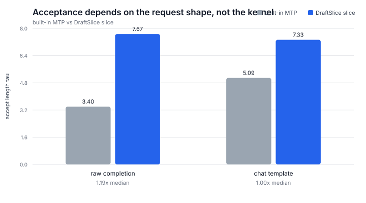

# The 6% that survived: exact draft-head slicing in a real serving stack

*A grammar-aware speculative-decoding prototype measured 1.19× on synthetic
completion prompts. On the production chat workload it was 1.00×. This is the
story of the one optimization that survived contact with a real server — and
the measurements that killed the rest.*

---

## 1. The surprise

The prototype was simple. For structured output, a grammar enumerates the tokens
the draft model may propose. Instead of scoring all 248,320 vocabulary rows with
the draft LM head, score only the valid ones. On paper this is an 11× faster
head: a full 4B head read is 1.27 GB and costs ~744 µs on an A100; the sliced
kernel costs ~65 µs for 128 rows.

An early benchmark showed 1.19× end-to-end on a single 4B MTP model. Then we
ran the same code through `vllm serve` and `/v1/chat/completions`.

Same engine. Same schema. Same tool calls. Only the prompt differed.

| Same engine, same tool cases, B=1, k=8, 3 reps | built-in τ | slice τ | built-in tok/s | slice tok/s | speedup |
|---|---:|---:|---:|---:|---:|
| raw completion prompt | 3.22 | 7.67 | 91.6 | 108.5 | **1.186×** |
| chat template (production) | 5.09 | 7.33 | 129.5 | 128.6 | **0.996×** |



The chat template makes the first ~15 tokens a highly predictable tool-call
prefix. The built-in draft model is already right at positions 0–1 (per-position
acceptance 252/266 and 252/266) and still ~47–65% later. On the raw string, the
draft is much weaker. Grammar masking can raise τ from 2.7 to 7.3 on the raw
prompt; on production it raises 5.1 to 7.3, a much smaller reduction in verify
steps. The kernel was fast in both cases. The baseline had changed.

**Lesson one: benchmark the request shape, not the prompt.**

## 2. Where the time actually goes

The second surprise was arithmetic. At k=8, B=1 on the production chat workload,
the draft LM head is **16.2%** of a verify step:

| metric | value |
|---|---:|
| wall time | 0.918 s |
| output tokens | 115 |
| verify steps | 19 |
| draft head calls | 200 |
| head calls per verify step | **10.5** |
| full head time per call | **0.744 ms** |
| draft head share of wall | **16.2%** |

That is real money. It is also already bandwidth-optimal: 1.27 GB / 0.744 ms ≈
1.72 TB/s, which is A100 HBM peak. No kernel tuning helps. The only way to make
it cheaper is to read fewer rows.

But the adapter that produced the rows cost more than the rows it saved. With
debug timers, per verify step:

| component | ms/step |
|---|---:|
| slice logits build | 2.49 |
| grammar shadow fork + D2H | 2.23 |
| contract emission | 0.61 |
| valid-set construction | 0.11 |
| sampled-token D2H | 0.08 |
| uninstrumented dispatch/sync/alloc | ~14.7 |
| **gross adapter tax** | **~20.3** |

Against a maximum head saving of `10.5 × (0.744 − 0.065) ≈ 7.1 ms/step`, a
20.3 ms tax cannot win. The tax came from rebuilding the GPU index tensor and
the output buffer on every call, from emitting a per-step contract and trace,
and from a blocking `.tolist()` after every draft position — eight
CPU/GPU synchronizations per verify step.

Notably, the tax was **per call**, not per byte: at k=1, where no grammar shadow
fork is needed, the slice arm was still 0.95×.

**Lesson two: the optimizer has to fit inside the head's budget, not beside
it.**

## 3. The lean patch

The shipping version, `DRAFTSLICE_VLLM_LEAN=1`, keeps the exact same candidate
sets and τ. It only changes how candidate logits are produced:

- **Cached device payloads.** For each exact candidate-set identity, keep a
  padded int32 token matrix and row index resident on the GPU. The grammar
  shadow already caches CPU `TokenSet`s by state, so payloads survive across
  steps and requests (2048-entry LRU).
- **Grouped rows.** Bucket by candidate width; identical grammar states across
  batch rows share one kernel launch and one weight read.
- **Reused output buffer.** One `[rows, vocab]` fp32 buffer per shape, refilled
  with `-inf`. No per-call `torch.full`.
- **One fused launch per group**, and full-head fallback only for rows with no
  valid set.
- **Telemetry off the hot path.** No per-step `DraftContract`/trace, no policy
  recording, no plan compile, no screener. The profile cell is still evaluated
  once per verify step if a table is configured.
- **A calibrated gate at startup.** An uncalibrated cost artifact disables
  slicing outright instead of paying the shadow tax and then returning the full
  head on every call.

Correctness did not move: greedy token ids equal to built-in on 6 tool cases ×
3 reps, validity 1.0, τ 7.33, accept rate 0.916.

Single-server production A/B, tool-only, 45 s, one engine at a time (do not run
three servers on one host — that inflated an earlier number to 0.94×):

| arm | tok/s | median | vs built-in |
|---|---|---:|---:|
| built-in MTP (9 reps) | 127.8 / 127.7 / 128.6 / 127.1 / 127.0 / 125.6 / 125.4 / 124.8 / 125.6 | 127.03 | 1.000× |
| old non-lean slice (6 reps) | 119.2 / 120.1 / 120.9 / 120.3 / 119.9 / 120.0 | 120.02 | 0.945× |
| **lean exact slice (3 reps)** | 134.9 / 133.8 / 134.8 | **134.76** | **1.061×** |

The 16.2% head budget does not become 16%. It shrinks at every step:

| quantity | value |
|---|---:|
| head calls per verify step | 10.5 |
| full / sliced head per call | 0.744 / 0.065 ms |
| exact-candidate coverage | **63%** (1517/2408 calls) |
| no-valid-set fallback | 37% |
| gross head saving | 4.49 ms/step |
| verify tax from higher τ (counterfactual) | **−3.0%** |
| realized head gain | **+7.8%** |
| **net** | **+4.6%** |

Masking raises τ from 5.04 to 7.33. On this hybrid GDN model the target verifies
1.63 more tokens per step at close to per-token cost, which spends about 3 points
of the head gain. Coverage spends another 37%. The rest is the residual per-call
adapter cost.

## 4. What the field already does

None of this is novel algorithmically, and it is worth saying so plainly.

- vLLM [PR #47885](https://github.com/vllm-project/vllm/pull/47885) adds
  grammar-aware draft sampling and reports +9% on mismatched CPU/A6000 and ~0%
  on H100. Our matched 4B A100 result (masking neutral on the chat shape) is
  consistent with the H100 row, not a contradiction.
- SGLang already builds a grammar mask for the **target verify** logits in
  `run_eagle_verify`, but not for the draft proposals. The same gap exists.
- SlimSpec, SpecVocab, and SGLang's hot-token maps all reduce head/vocabulary
  bytes from other angles; a grammar candidate set is the exact special case for
  structured traffic.

The grammar-shadow idea is table stakes. The residue we could defend is the
**exact row slice plus a calibration gate**, and even that is engineering rather
than a new algorithm.

## 5. When to use it

The decision matrix we would actually give a team:

| situation | recommendation |
|---|---|
| matched drafter, free-form traffic | built-in. Nothing to slice. |
| matched drafter, structured traffic, B=1 | lean exact slice if you can accept ~6%; check your own A/B |
| mismatched or slow drafter | draft-side grammar guidance is more promising than slicing |
| B≥8 production | gate by profile cell; the earlier B=8 results were regressions |
| CUDA graph required | the current hooks are bypassed in this build; stay eager or port the mask/rows into the graph |
| quantized or TP>1 | the lean path is disabled; keep the stock head |

And two measurement rules that cost us the most time:

1. Use the production request template and sampling parameters, not a bare
   prompt.
2. Benchmark one engine per host. Co-located servers change the adapter tax and
   the baseline.

## 6. Negative results

The value of the exercise is mostly in the things that did not ship:

- **Static top-16k vocabulary screener (free-form).** τ 5.09 → 3.62, throughput
  129.7 → 45.8 tok/s (**0.35×**). A candidate-free shortcut loses exactly the
  tokens the draft needs.
- **int8 draft head.** At 1.07% relative weight error, τ 5.087 → 4.933
  (**−3.0%**); per-tensor was −9.0%. With lean masking the grammar set removes
  the int8-induced wrong argmax (τ unchanged at 7.333), so int8 only helps the
  37% full-head fallbacks. Not worth a custom kernel and a second 0.64 GB copy
  yet.
- **DFlash all-position slicing.** Full-head negative; block positions after 0
  have no exact per-position grammar state, and the measured all-position path
  was 0.78×.
- **Per-step `DraftContract`.** It looked like an engine contract but had no
  vLLM/SGLang consumer. It is DraftSlice's own audit trail; lean drops it. If
  auditability matters, sample 1% or keep counters, not a contract per step.
- **CUDA graph.** The SGLang draft-head hook is never reached under graph replay
  in this build. Disabling the graph costs more (≈182 → ≈60 tok/s on 4B EAGLE)
  than the slice saves. Supporting the graph is a separate project.
- **Plan session on the hot path.** Compiling a `StepPlan` per step added 6.9%
  at B=1 k=8 while the executor still executed the legacy path. Default plan
  mode is now `off`.

## 7. Code and reproduction

The public prototype is in
[`0515wlx/draftslice`](https://github.com/0515wlx/draftslice). The lean path is
opt-in:

```bash
DRAFTSLICE_VLLM=1 DRAFTSLICE_VLLM_SLICE=1 DRAFTSLICE_VLLM_LEAN=1 \
  vllm serve Qwen/Qwen3.5-4B --enforce-eager \
  --speculative-config '{"method":"draftslice_mtp","num_speculative_tokens":8}'
```

The design note with the full accounting, gates, and limitations is
[`docs/lean-slice.md`](../lean-slice.md). Raw JSON and the debugging reports are
kept out of the published tree (they contain host paths); the tables above are
the reproducible summary.

If you take one thing away: **the head is 16% of the step, and the exact
candidate set is 63% of the head. Everything else is the cost of getting out of
the way.**
